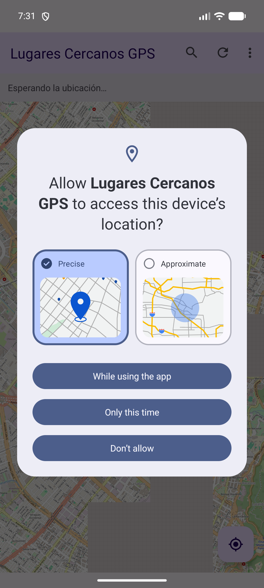
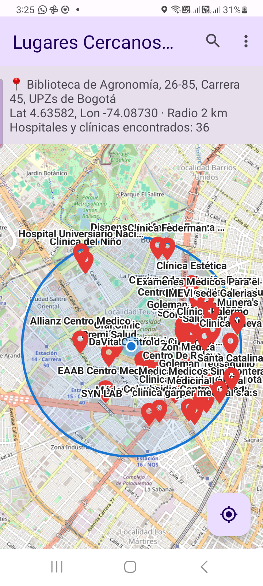
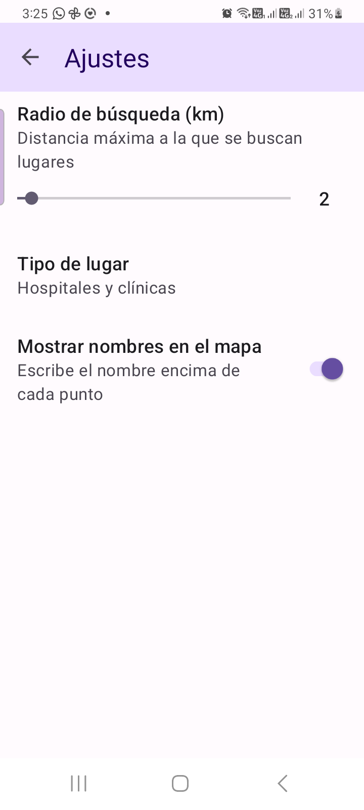
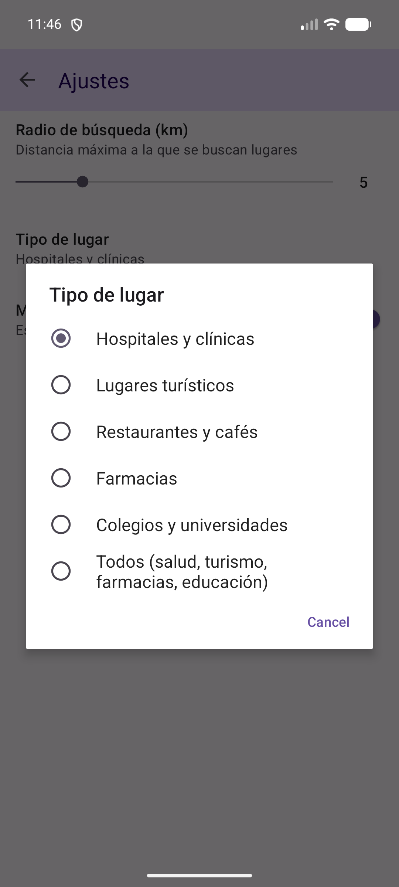
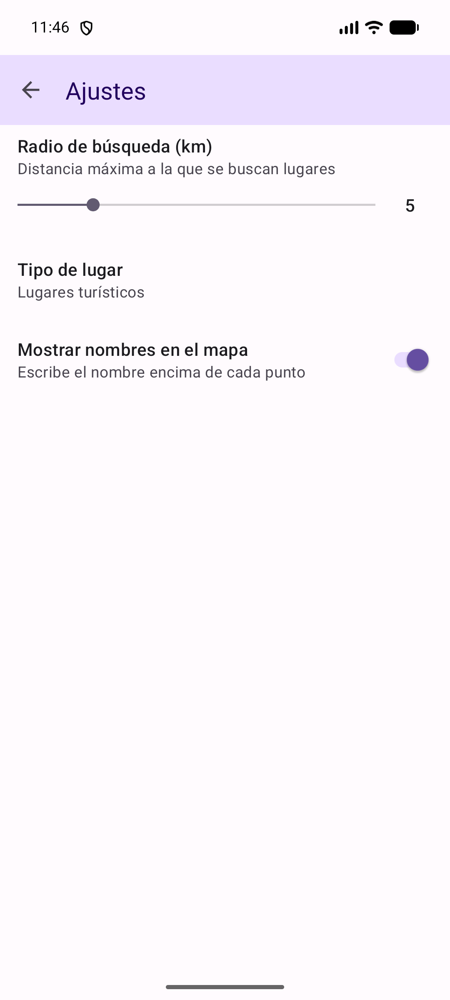
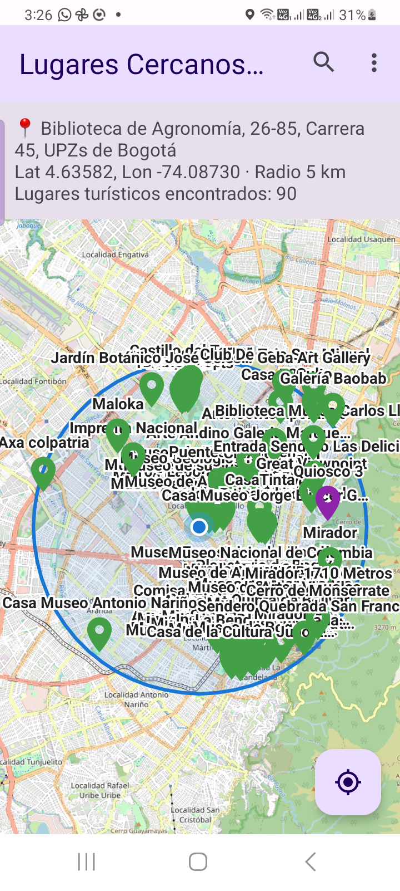
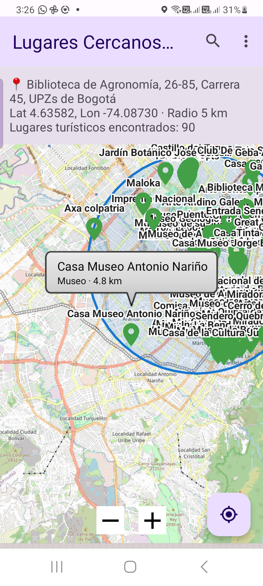
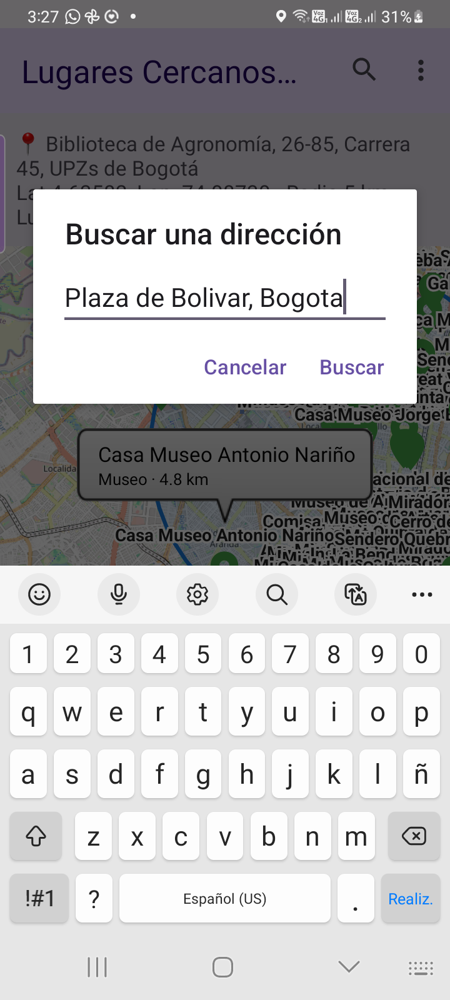
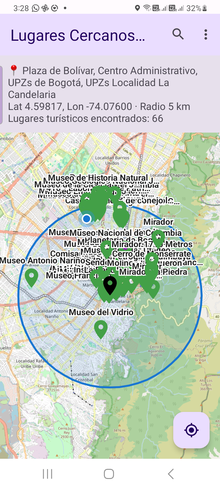

# Reto 9 – Accediendo al GPS

App Android (Kotlin) que obtiene la ubicación del dispositivo y muestra en un mapa de **OpenStreetMap** los lugares de interés cercanos (hospitales, sitios turísticos, restaurantes, farmacias, colegios…) dentro de un **radio en km configurable** desde las preferencias.

## 🎥 Video de demostración

> **Enlace al video:** _(pegar aquí el enlace de YouTube o Drive)_

## Funcionalidades

- **Permisos de ubicación en tiempo de ejecución** (`ACCESS_FINE_LOCATION` / `ACCESS_COARSE_LOCATION`), con un diálogo que explica por qué se necesitan.
- **Ubicación GPS** con `LocationManager` (sin depender de Google Play Services).
- **Mapa OpenStreetMap** (osmdroid) con la posición del usuario y un círculo que marca el radio de búsqueda.
- **Lugares cercanos** consultados con la **Overpass API**, mostrados como marcadores con su nombre; al tocar uno se ve su tipo y la distancia.
- **Búsqueda por dirección** con la geocodificación de **Nominatim**.
- **Pantalla de Ajustes:**
  - Radio de búsqueda: de 1 a 20 km.
  - Tipo de lugar: hospitales y clínicas, lugares turísticos, restaurantes y cafés, farmacias, colegios y universidades, o todos.
  - Mostrar u ocultar los nombres en el mapa.

## Capturas de pantalla

| Permiso de ubicación | Hospitales en 2 km | Ajustes |
|:---:|:---:|:---:|
|  |  |  |

| Tipo de lugar | Ajustes modificados (5 km, turísticos) | Lugares turísticos en 5 km |
|:---:|:---:|:---:|
|  |  |  |

| Detalle de un lugar | Buscar una dirección | Resultado de la búsqueda |
|:---:|:---:|:---:|
|  |  |  |

## Estructura del código

| Archivo | Descripción |
|---|---|
| `app/src/main/java/co/edu/unal/reto9gps/MainActivity.kt` | Permisos, ubicación GPS, mapa, marcadores y búsqueda por dirección |
| `app/src/main/java/co/edu/unal/reto9gps/OsmRepository.kt` | Consultas a la Overpass API (lugares) y a Nominatim (direcciones) |
| `app/src/main/java/co/edu/unal/reto9gps/SettingsActivity.kt` | Pantalla de preferencias |
| `app/src/main/res/xml/preferences.xml` | Definición de los ajustes (radio, tipo de lugar, nombres) |

## Tecnologías

- Kotlin · Android SDK (minSdk 24)
- [osmdroid](https://github.com/osmdroid/osmdroid) 6.1.20: mapas de OpenStreetMap
- [Overpass API](https://overpass-api.de/): búsqueda de puntos de interés
- [Nominatim](https://nominatim.org/): geocodificación de direcciones
- AndroidX Preference: pantalla de ajustes

## Cómo ejecutarlo

1. Abrir el proyecto en Android Studio.
2. Ejecutarlo en un dispositivo o emulador con conexión a Internet.
3. En el emulador, fijar una ubicación en **⋯ (Extended controls) → Location**.
4. Aceptar el permiso de ubicación al abrir la app.

---
Desarrollo de Aplicaciones para Dispositivos Móviles – Universidad Nacional de Colombia
